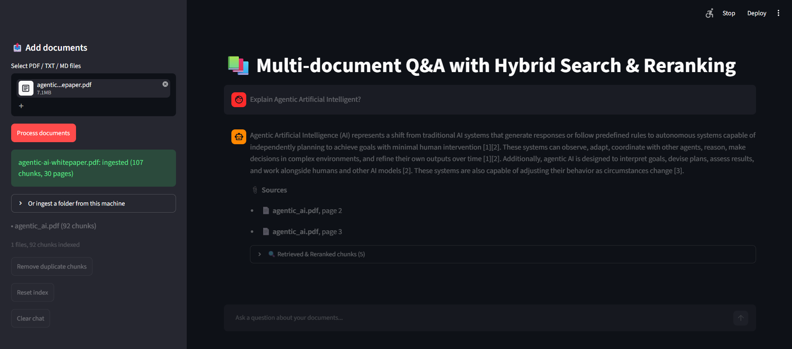

# 📚 Multi-Document Hybrid RAG Q&A System

A robust, layout-aware Retrieval-Augmented Generation (RAG) web application built with **Streamlit**, **LangChain**, **FAISS**, **Rank-BM25**, **Cross-Encoder Reranking**, **Google Gemini**, and **LangSmith**.

Unlike naive RAG pipelines, this application implements an advanced document processing, hybrid retrieval, persistence, and evaluation tracing pipeline to ensure precise context extraction, zero redundancy, and full observability.

---

## Application UI



## 🏗️ System Architecture & Workflow

The application follows a complete lifecycle from document management to generation and tracing:

1. **Ingestion & Registry Check:** Hashes uploaded files to prevent processing duplicate files already indexed on disk.
2. **Layout-Aware Parsing:** Extracts text while preserving structure (headings, lists, and tables) using `pymupdf4llm`.
3. **Noise & Furniture Removal:** Strips out running headers, footers, page numbers, tables of contents, and references.
4. **Content-Aware Chunking:** Segments text based on structural sections and sentence boundaries.
5. **Vector Indexing & Storage (FAISS):** Embeds chunks and saves the index locally, filtering out duplicate text chunks.
6. **Hybrid Retrieval Strategy:** Combines **Semantic Vector Search (FAISS)** and **Keyword Search (BM25)** using Reciprocal Rank Fusion (RRF).
7. **Cross-Encoder Reranking:** Re-scores the retrieved candidate pool using a cross-encoder model.
8. **LLM Generation & Tracing (LangSmith + Gemini):** Passes the top 5 reranked chunks into Google Gemini while tracking runs via LangSmith.

---

## 🔍 Core Strategies & Components Explained

### 1. Document Extraction & Cleaning Strategy
* **Layout Preservation:** For PDFs, `pymupdf4llm` converts pages into structured Markdown, ensuring tables are retained as Markdown tables and headers are identified by font size hierarchies.
* **Page Furniture Removal:** Running headers and footers that repeat across multiple pages are automatically detected and stripped out. Page numbers and boilerplate noise are filtered.
* **Junk Filtration:** Content chunks resembling Bibliographies, References, or Tables of Contents are automatically dropped based on keyword density checks.

### 2. Content-Aware Chunking Strategy
* **Section-Boundary Respect:** Documents are split into logical blocks under heading trails (e.g., `Section: Introduction > Background`). Chunks never cross heading boundaries.
* **Granular Control:** 
  * `CHUNK_SIZE = 800` characters.
  * `CHUNK_OVERLAP = 150` characters (enforced at sentence/paragraph boundaries).
* **Tail Merging:** Tiny residual trailing pieces of a section (< 200 characters) are merged into the preceding chunk to preserve context continuity.

### 3. Embedding Strategy
* **Model:** `sentence-transformers/all-MiniLM-L6-v2` via LangChain's HuggingFace embeddings.
* **Purpose:** Converts document chunks and user queries into dense vector embeddings. 
* **Why this model?** It balances a low memory footprint, high execution speed, and strong semantic retrieval performance for local execution inside Streamlit.

### 4. FAISS Vector Store & Persistence Layer
* **Local Disk Persistence:** The vector store is saved locally inside the `faiss_index/` directory (`index.faiss` and associated pickle files) so data persists across application restarts.
* **Registry Tracking (`registry.json`):** Tracks MD5 hashes of uploaded files (`file_hash: file_name`). If a user uploads a file that has already been ingested, the app instantly skips it.
* **Chunk-Level Deduplication:** Computes unique hashes for chunks (`file | page_number | text_content`) to ensure duplicate chunks aren't added to the vector space. A utility button (`Remove duplicate chunks`) is also provided in the sidebar.

### 5. Hybrid Retrieval Strategy (Semantic + Keyword)
To overcome the limitations of relying purely on vector similarity (which can miss exact keyword matches) or pure keyword search (which fails on semantic synonyms), a hybrid approach is used:
* **Semantic Retriever (FAISS):** Performs dense vector similarity search to capture conceptual meaning and synonyms.
* **Keyword Retriever (BM25):** Extracts all documents from the FAISS store and builds a local `BM25Retriever` instance for sparse lexical keyword matching.
* **Ensemble Fusion (RRF):** LangChain's `EnsembleRetriever` merges the ranked lists from both FAISS and BM25 (weighted 60% semantic, 40% keyword) via Reciprocal Rank Fusion.

### 6. Reranking Strategy
* **Model:** `cross-encoder/ms-marco-MiniLM-L-6-v2` via `sentence_transformers`.
* **The Cross-Encoder Solution:** While bi-encoders embed queries and documents separately, the cross-encoder evaluates the **query and candidate document text jointly** in a single transformer pass to capture deep fine-grained semantic interactions.
* **Top-K Selection:** Scores all combined candidates, sorts them by relevance score descending, and strictly filters down to the **top 5 documents (`TOP_K = 5`)** before sending them to the LLM.

### 7. LangSmith Tracing Integration
* **Observability:** Automatically hooks into LangSmith using modern (`LANGSMITH_*`) or legacy (`LANGCHAIN_*`) environment variables.
* **Tracing Configuration:** When enabled, it tracks execution traces, latency, token consumption, and metadata (`k`, `mmr`, tags like `rag`, `faiss`, `gemini`) under the configured project name (`document-qa-rag`).

### 8. LLM Generation & Citation Management
* **Model:** Google Gemini (`gemini-3.8-flash`) with `TEMPERATURE = 0.0` for deterministic, factual adherence.
* **Strict Prompting:** The prompt instructs the model to use *only* the provided numbered context sources. If missing, it outputs a strict fallback message (`No any data available regarding the question`).
* **Clean Citations:** Post-processing maps model references back to clean numeric citations (`[1]`, `[2][3]`) without cluttering text with filenames and page numbers.

---

## 🚀 Getting Started

### Prerequisites
* Python 3.10+
* A Google Gemini API Key (`GOOGLE_API_KEY` or `GEMINI_API_KEY`)
* Optional: A LangSmith API Key (`LANGSMITH_API_KEY`) for tracing

### Installation

1. Clone the repository and navigate to the project directory.
2. Install the required dependencies:
   ```bash
   pip install streamlit langchain langchain-community langchain-google-genai langchain-huggingface pymupdf pymupdf4llm sentence-transformers rank-bm25 python-dotenv 
   ```
3. Create a .env file in the root directory and configure your keys:
   ```GOOGLE_API_KEY=your_gemini_api_key_here
    # Optional LangSmith Tracing
    LANGSMITH_API_KEY=your_langsmith_api_key_here
    LANGSMITH_TRACING=true
    LANGSMITH_PROJECT=document-qa-rag
   ```

### Running the App
    Launch the Streamlit interface:
    ```
      Bash
      streamlit run app.py
    ```
